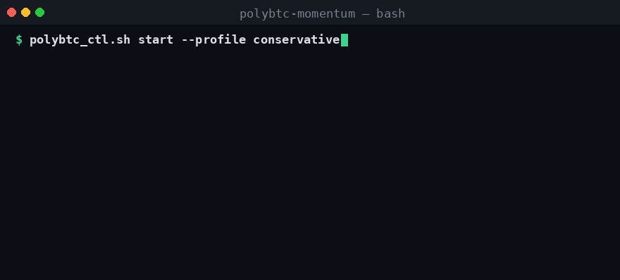
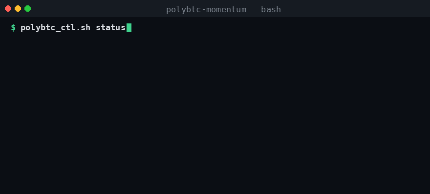

<div align="center">


# PolyBTC Momentum

**Skill OpenClaw open-source untuk trading momentum BTC 5 menit Up/Down di Polymarket**

[](https://github.com/0xgetz/polymarket-btc-5m/actions/workflows/ci.yml)


[**English**](README.md) · [**Bahasa Indonesia**](README.id.md) · [**简体中文**](README.zh-CN.md)

</div>

---

## Daftar Isi

- [Demo](#-demo)
- [Strategi: Momentum ke Penutupan](#-strategi-momentum-ke-penutupan)
- [Profil Trading](#-profil-trading)
- [Ekspektasi yang Realistis](#-ekspektasi-yang-realistis)
- [Struktur Repository](#-struktur-repository)
- [Memulai](#-memulai)
- [Penggunaan](#-penggunaan)
- [Keamanan Live (Pasca-Audit)](#-keamanan-live-pasca-audit)
- [Perkakas & Validasi](#-perkakas--validasi)
- [Tes & CI](#tes--ci)
- [Checklist Eksekusi](#-checklist-eksekusi)
- [Kontrol Risiko](#-kontrol-risiko)
- [Pernyataan Risiko](#-pernyataan-risiko)
- [Dukungan & Kontribusi](#-dukungan--kontribusi)

---

## 🎬 Demo

### Sesi Trading Live (profil conservative)

<p align="center">
  
</p>

> Selesaikan market BTC 5m → konfirmasi impulse + skew + edge → masuk dengan momentum → keluar terkelola sebelum penutupan.

### Laporan Status & PnL

<p align="center">
  
</p>

---

## 🎯 Strategi: Momentum ke Penutupan

Stack **momentum-ke-penutupan** horizon pendek — ini *bukan* sistem pembalikan (reversal):

1. **Trading** di market Polymarket BTC 5m Up/Down mendekati waktu habis (expiry).
2. **Waktu masuk** sekitar **~120 detik tersisa** (toleransi / jendela keras dapat dikonfigurasi).
3. **Impulse** — wajib ada pergerakan BTC **bertanda** pada candle 5m aktif (`close − open`), dengan **konfirmasi 1m** opsional (anti-wick).
4. **Skew** — ikuti pasar: ask CLOB lebih kuat di atas ambang; opsional `min_skew_gap` dan `max_entry_price`.
5. **Gate edge** — wajib `est_win_prob − entry ≥ min_edge`; opsional **jam sesi** UTC.
6. **Ukuran posisi** — stake tetap atau **berskala-edge** (batas profil), dengan **penurunan ukuran lembut saat streak rugi** opsional.
7. **Keluar** — stop keras pada bid CLOB, **hold-to-resolve** saat hampir pasti, **early-cut** jika rugi atau BTC berbalik mendekati expiry, jika tidak keluar berdasarkan waktu.
8. **Hedge** — micro-hedge opsional pada skew ekstrem mendekati penutupan (mis. 95/5).

Semua parameter profil hanya ada di **`config/polybtc_profiles.yaml`**.

---

## 📊 Profil Trading

| Profil | Tujuan |
|---|---|
| `conservative` | Jalur live default: filter lebih ketat, gate edge, blokir sesi, ukuran berskala-edge |
| `aggressive` | Frekuensi / risiko lebih tinggi, edge & sesi lebih longgar |
| `high_confidence` | Pita ambang menengah-tinggi selektif, impulse lebih keras, lebih banyak poll konfirmasi |
| `micro_10` | **Uji live kecil** — bankroll ~10 USDT, **$1/trade**, maks 5 trade/hari |
| `observe` | **Hanya riset** — gate longgar untuk `polybtc_live_logger` / dry-run; **bukan untuk uang asli** |

### Uji mikro dengan ~10 USDT

Gunakan profil `micro_10` dan setel equity ke bankroll Anda agar persentase rugi harian bermakna:

```bash
# 1) Dry-run dulu (tanpa pesanan)
export POLYBTC_EQUITY=10
python scripts/test_polybtc_session_exit_sl.py --profile micro_10

# atau via ctl:
scripts/polybtc_ctl.sh start --profile micro_10

# 2) Hanya setelah dry-run terlihat wajar — pesanan $1 ASLI (dompet harus berisi ~10 USDT):
export POLYBTC_EQUITY=10
scripts/polybtc_ctl.sh start --profile micro_10 --live
# setara dengan:
python scripts/test_polybtc_session_exit_sl.py --profile micro_10 --equity 10 --execute
```

Batas `micro_10`: stake **$1**, notional maks **$1**, maks **5** trade/hari, berhenti setelah **2** kekalahan beruntun, rugi harian maks **20% dari equity** (≈$2 jika equity=10). Hedge nonaktif. Anda tetap bisa kehilangan seluruh saldo dalam beberapa hari.

---

## 📈 Ekspektasi yang Realistis

> **Tidak ada jaminan untung.** Ini adalah strategi spekulatif dengan varians tinggi. **Tidak ada setup yang menjamin profit**, dan siapa pun yang menjanjikan "win rate 99%" sedang menyesatkan Anda. Imbalannya asimetris — Anda membeli satu sisi di harga `p`, jadi **win-rate titik impas Anda sama dengan `p`**: Anda harus benar *lebih* dari `p`% hanya untuk tidak rugi.

| Harga masuk | Imbalan menang (stake $5) | Rugi | Win-rate titik impas |
|---|---|---|---|
| 0.71 | +$2.04 | −$5.00 | **> 71%** |
| 0.90 | +$0.56 | −$5.00 | **> 90%** |
| 0.95 | +$0.26 | −$5.00 | **> 95%** |

Pada 0.71, satu kekalahan menghapus ~2.4 kemenangan. Tujuan realistisnya adalah **edge positif yang terukur dengan proteksi modal ketat** — bukan kemenangan yang dijamin. Gunakan perkakas analytics, edge, exit, dan fill (lihat [Perkakas & Validasi](#-perkakas--validasi)) untuk memverifikasi ekspektasi nyata sebelum memperbesar ukuran.

---

## 🗂 Struktur Repository

| Path | Kegunaan |
|---|---|
| `SKILL.md` | Definisi skill dan aturan operasional |
| `CONTOUR.md` | Jalur eksekusi kanonik + catatan keamanan pasca-audit |
| `BACKTESTING.md` | Panduan backtest CSV historis + kalibrator |
| `config/polybtc_profiles.yaml` | Satu sumber kebenaran untuk profil / risiko |
| `scripts/` | Runner, preflight, analytics, live logger, laporan (`_psr_impl.py` adalah implementasi sesi live) |
| `examples/` | Contoh perintah + CSV backtest sampel |
| `assets/` | Logo dan GIF demo |
| `tests/` | pytest (config, preflight, edge, guardrails, analytics, dry-run, summary, live safety, backtest, calibrate, laporan exit/fill, CSV logger) |
| `.github/workflows/` | CI (lint, compile, validasi config, tes) |

---

## 🚀 Memulai

### Prasyarat

- Lingkungan OpenClaw (opsional untuk perkakas Python murni)
- Stack eksekusi Polymarket untuk **pesanan asli** (mis. `pm-hl-conservative-plus-repo`)
- Venv Python 3.12+: `pip install -r requirements.txt` (dan `requirements-live.txt` untuk klien CLOB)
- Kredensial API hanya di luar repo ini (via env / `.env` eksternal)

### Quick Start

```bash
git clone https://github.com/0xgetz/polymarket-btc-5m.git
cd polymarket-btc-5m
pip install -r requirements.txt
```

Lalu baca:

- `SKILL.md`
- `config/polybtc_profiles.yaml`

---

## 💻 Penggunaan

### Hanya observasi (tanpa pesanan — langkah pertama yang baik)

```bash
python scripts/polybtc_live_logger.py --profile observe --minutes 60 --poll-sec 5
# JSONL + CSV masuk ke ./runtime/
```

### Runner sesi dry-run (default — tanpa pesanan)

```bash
python scripts/test_polybtc_session_exit_sl.py --profile conservative
# atau:
scripts/polybtc_ctl.sh start --profile conservative
scripts/polybtc_ctl.sh start --profile high_confidence   # selektif
```

### Live — hanya setelah validasi (flag eksplisit wajib)

```bash
python scripts/test_polybtc_session_exit_sl.py --profile conservative --execute
scripts/polybtc_ctl.sh start --profile conservative --live
```

### Kontrol skill terpadu

```bash
scripts/polybtc_ctl.sh start --profile conservative          # dry-run
scripts/polybtc_ctl.sh start --profile conservative --live   # pesanan asli
scripts/polybtc_ctl.sh status
scripts/polybtc_ctl.sh report --limit 20
scripts/polybtc_ctl.sh stop   # SIGTERM dulu; bisa meninggalkan posisi terbuka jika dihentikan di tengah trade
```

### Docker opsional

```bash
scripts/polybtc_docker.sh up
scripts/polybtc_docker.sh status
scripts/polybtc_docker.sh down
```

---

## 🛡 Keamanan Live (Pasca-Audit)

Default menjaga uang asli agar sulit diaktifkan tanpa sengaja:

| Kontrol | Perilaku |
|---|---|
| **Mode default** | Dry-run (tanpa pesanan). Live butuh `--execute` / `polybtc_ctl.sh --live`. |
| **Gate preflight** | Waktu, impulse BTC 5m **bertanda** (+ batas maks), **align 1m** opsional, usia quote, spread, likuiditas, ambang / `max_entry`, gap skew, konfirmasi multi-poll, **gate EV**, **jam sesi** — sebelum open apa pun. |
| **Ukuran posisi** | Stake dasar + opsional **edge-scale** + **soft scale streak rugi**, `max_notional_usd` keras. |
| **Pagar modal** | Kill switch kekalahan beruntun, % rugi harian maks, maks trade/hari. |
| **Sumber profil** | Hanya `config/polybtc_profiles.yaml` (`polybtc_config`). |
| **Exit terkelola** | Stop pada bid terbaik CLOB; hold-to-resolve; early-cut; time exit (`decide_exit`). |
| **Lantai limit close** | Close paksa/GTC tidak bisa dibuang di bawah `entry * (1 - max_close_slippage)`. |
| **Env open-order** | Spread / notional top-ask dari profil (`PM_MAX_SPREAD`, `PM_MIN_TOP_ASK_NOTIONAL_USD`). |
| **Semantik stop** | `polybtc_ctl.sh stop`: SIGTERM → tunggu → SIGKILL; lockfile + peringatan posisi terbuka. |
| **Watcher** | `watch_polybtc_threshold_and_enter.sh` default dry-run; lockfile; berhenti saat guardrail memblokir. |

Helper: `scripts/polybtc_live_safety.py` (diuji unit). Deps CLOB live: `requirements-live.txt`.

Isolasi runtime:

- direktori runtime skill: `./runtime`
- sumber auth/env (default): `<your-workspace>/pm-hl-conservative-plus-repo/.env`
- override: `POLYBTC_REPO`, `POLYBTC_ENV_FILE`, `POLYBTC_RUNNER`, `POLYBTC_RUNTIME_DIR`, `POLYBTC_PY`

---

## 🧪 Perkakas & Validasi

Sebagian besar helper murni / deterministik (atau observasi-saja via API publik). Gunakan dulu sebelum memperbesar ukuran live.

### Validator config

```bash
pip install -r requirements.txt
python scripts/polybtc_config.py --validate
python scripts/polybtc_config.py --profile conservative --show
python scripts/polybtc_config.py --profile observe --show
```

### Gate preflight

Mesin GO / NO-GO: sisi, stake (skala edge + streak), stop, rencana hedge, checks, edge.

```bash
python scripts/polybtc_preflight.py --profile conservative \
  --seconds-left 118 --btc-move-usd 110 --btc-move-1m-usd 12 \
  --up-ask 0.74 --dn-ask 0.28 --spread 0.02 --top-ask-notional 50 \
  --hour-utc 14
```

Contoh GO (bentuk; nilai bergantung pada profil):

```json
{
  "ok": true,
  "side": "UP",
  "entry_price": 0.74,
  "stake_usd": 6.25,
  "edge": 0.08,
  "estimated_win_prob": 0.82,
  "stake_scale": 1.25,
  "streak_scale": 1.0,
  "checks": {
    "session_hour": true,
    "time_to_close": true,
    "impulse_move": true,
    "impulse_max": true,
    "quote_fresh": true,
    "spread": true,
    "liquidity": true,
    "threshold_side": true,
    "move_aligned": true,
    "move_1m_aligned": true,
    "skew_confirm": true,
    "ev_gate": true
  }
}
```

### Live observe logger + ekspor CSV (tanpa pesanan)

```bash
python scripts/polybtc_live_logger.py --profile observe --minutes 60 --poll-sec 5
python scripts/polybtc_live_logger.py --export-jsonl runtime/polybtc_live_obs_....jsonl
```

### Kalibrator akurasi (grid search CSV)

```bash
python scripts/polybtc_calibrate.py \
  --csv examples/polybtc_backtest_sample_data.csv \
  --profile conservative --top 10 --min-trades 2
```

Detail: `BACKTESTING.md`.

### Backtest (replay CSV melalui preflight)

```bash
python scripts/polybtc_backtest.py \
  --csv examples/polybtc_backtest_sample_data.csv \
  --profile conservative
```

### Laporan setelah paper/live

```bash
python scripts/polybtc_analytics.py --runtime-dir ./runtime --limit 200
python scripts/polybtc_exit_report.py --runtime-dir ./runtime --limit 200
python scripts/polybtc_fill_report.py --runtime-dir ./runtime --limit 200
python scripts/polybtc_daily_summary.py --profile conservative --equity 200
```

### Guardrails / matematika edge / dry-run

```bash
python scripts/polybtc_guardrails.py --profile conservative \
  --equity 200 --pnls=-5,-5,-5 --entry 0.71 --win-prob 0.80
python scripts/polybtc_edge.py --entry 0.71 --win-prob 0.80 --stake 5
python scripts/polybtc_edge.py --table
python scripts/polybtc_dryrun.py --profile conservative \
  --seconds-left 118 --btc-move-usd 84 --btc-move-1m-usd 10 \
  --up-ask 0.71 --dn-ask 0.29 --spread 0.02 --top-ask-notional 41 \
  --hour-utc 14 --market-slug btc-updown-5m-demo --outcome UP
```

### Tes & CI

```bash
pip install -r requirements-dev.txt
pytest -q
```

CI menjalankan pemeriksaan sintaks bash/Python, validasi config, dan seluruh rangkaian tes.

---

## ✅ Checklist Eksekusi

> Sebelum trade live.

1. **Validitas market** — slot BTC 5m aktif, belum ditutup.
2. **Jendela waktu** — cukup `min_entry_seconds_left`; prefer jendela target ~120s.
3. **Impulse** — pergerakan 5m bertanda ≥ `btc_move_usd_min`, ≤ `btc_move_usd_max` jika disetel; sisi sejajar.
4. **Konfirmasi 1m** — jika `require_1m_aligned`, candle 1m saat ini searah dengan sisi.
5. **Skew / pita harga** — sisi ambang, opsional `min_skew_gap` dan `max_entry_price`.
6. **Gate EV** — edge heuristik ≥ `min_edge` saat `require_ev_gate` aktif.
7. **Jam sesi** — jam UTC tidak diblokir (atau dalam daftar izin) jika filter sesi aktif.
8. **Multi-poll** — `confirm_polls` streak GO sisi sama sebelum open.
9. **Likuiditas / spread / usia quote** — lulus keamanan eksekusi profil.
10. **Ukuran posisi** — stake, edge-scale, loss-streak scale, notional maks, batas harian.
11. **Kebijakan exit** — stop-loss, hold-to-resolve, early-cut, `exit_before_sec`.
12. **Mode** — dry-run / observe logger dulu; `--execute` hanya setelah validasi.

---

## 🧰 Kontrol Risiko

Default ada di `config/polybtc_profiles.yaml` dan ditegakkan pada jalur live:

- Stake dasar per trade + ukuran **berskala-edge** + **soft size streak rugi**
- **Notional maks** keras / trade
- % rugi harian maks dan maks trade / hari
- Maks kekalahan beruntun (kill switch keras)
- Guard staleness quote, spread, dan likuiditas top-of-book
- Stop-loss pada **bid terbaik CLOB** yang dapat dieksekusi
- Lantai limit close (tanpa jual murah 0.01 secara default)
- Exit terkelola: hold-to-resolve / early-cut / time exit
- Micro-hedge skew ekstrem opsional
- Jam sesi izinkan/blokir (UTC)
- Penghentian proses yang anggun: SIGTERM → tunggu → SIGKILL

---

## ⚠️ Pernyataan Risiko

Repository ini adalah **infrastruktur edukasional/operasional, bukan nasihat keuangan**.
Gunakan batas risiko, batas rugi harian, dan kontrol modal Anda sendiri.

**`observe` hanya untuk pencatatan riset — jangan aktifkan uang asli padanya.**

---

## 💖 Dukungan & Kontribusi

Jika skill ini bermanfaat untuk trading atau riset Anda, dukung pengembangannya:

<p align="center">
  <a href="https://saweria.co/0xgetz">
    
  </a>
</p>

Donasi membantu untuk:

- 🖥️ Biaya server & data feed untuk pengujian strategi
- ✨ Fitur baru (filter impulse, multi-market, dashboard)
- 📚 Dokumentasi & contoh yang lebih baik
- 🐛 Perbaikan bug dan pemeliharaan rutin

🔗 **https://saweria.co/0xgetz**

### Kontribusi

- Fork repository
- Buat branch fitur
- Commit perubahan Anda
- Buka pull request ke `main`

PR dipersilakan.
